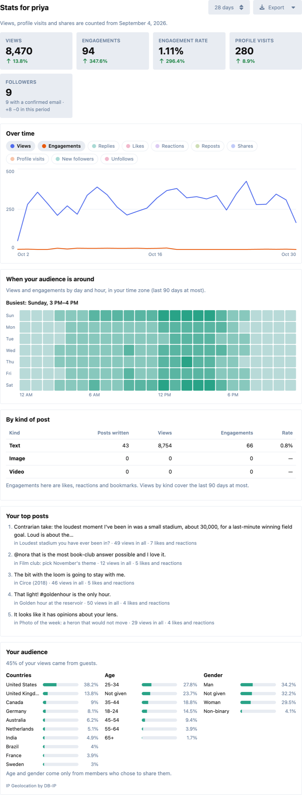
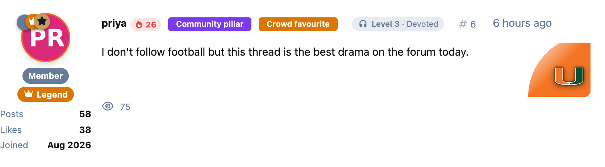
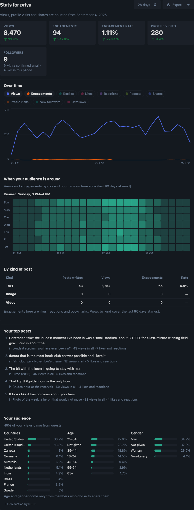
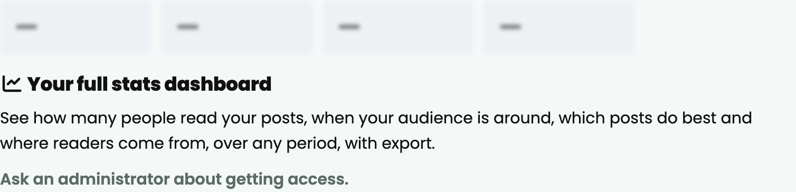

# Vantage

Account analytics for every member of your [Flarum 2](https://flarum.org) forum.

Everyone gets a view count under each post. The groups you choose also get a full **Stats** tab on their profile:

- **Views, engagements, engagement rate and profile visits**, each compared with the period before.
- **Rolling periods:** 24 hours, 7, 28, 90 and 365 days, and all time.
- **An interactive chart** of views, replies, likes, reactions, bookmarks, reposts, shares, profile visits, new followers and unfollows.
- **When your audience is around:** a day-by-hour grid in your own time zone.
- **By kind of post:** text, image and video.
- **Your top posts** in the period.
- **Your audience:** countries, and age and gender if you turn that on (see Privacy).
- **Export** to CSV or JSON.



Views under each post, for everyone:



It works on phones and in dark mode, and a member without access sees what they'd get and which groups have it:





Followers come from [Follow Users](https://github.com/imorland/follow-users), likes from Likes, reactions from FoF Reactions, bookmarks from FoF Bookmarks and reposts from Moments. Each one appears when its extension is enabled. These already have dates, so their history goes back to day one. Views, profile visits, shares and unfollows are counted from the day Vantage is installed.

## Who sees what

| Permission | Default | Gives |
|---|---|---|
| See views under posts | Everyone | The view count under each post (a setting can limit it to the post's author) |
| Use the Stats dashboard | Nobody | The member's own dashboard |
| See any member's Stats dashboard | Moderators | Anyone's dashboard |

Because the dashboard is a group permission, you can give it however you like: by hand, through Kiosk or any other paid-group extension. A member without it sees what the dashboard offers and which groups get it.

## Light on your forum

- **A view is a post that was on screen for a second.** The browser sends the posts a visitor has seen in one small request every few seconds while they read, so a visit counts even when they only read the first post, or close an in-app browser (Facebook, Instagram, X, Telegram) without leaving the page normally. Each reader counts once per post per day.
- **Members are also counted from Flarum's own read position**, which it already saves, with no extra request.
- **Crawlers and Global Privacy Control are skipped**, and a script hammering the counter is cut off. A setting turns guest counting off.
- **Counts are written in one batched insert** and folded into daily history every 15 minutes by the scheduler. Without a scheduler they are folded in whenever a dashboard is opened and every so often as visitors read, so nothing waits.
- **The views under posts cost one query** for the whole page of posts.
- **The script every visitor downloads is about 3.8 KB gzipped.** The dashboard is its own chunk, loaded only when it's opened.

## Privacy

- Vantage **never stores who read, visited or shared what.** Its tables hold the *author's* counts only. Readers are deduplicated with keys that live in the cache for one day; guests are a hash with a daily salt. No IP address is ever written.
- **Members can opt out** in Settings: "Don't count my reads and visits in other members' stats".
- **Countries** come from a proxy's header (Cloudflare's CF-IPCountry) or from DB-IP's free country file, which is downloaded to your server once a month only if needed. Lookups happen on your server. A country with fewer than 5 readers shows as "Other".
- **Age and gender are off by default.** When you turn them on, members can share a birth year and gender in Settings. Nobody is included until they choose to be. Under-18s are never counted, a bar needs 10 readers or more, and the breakdown needs 50.
- With [GDPR](https://github.com/flarum/gdpr), members' statistics are included in their data export and erased with their account.

## Install

```sh
composer require ernestdefoe/vantage
php flarum migrate
php flarum cache:clear
```

Running Flarum's scheduler (`php flarum schedule:run` every minute) is recommended for the 15-minute rollup and the monthly country file, but not required: without it, numbers are folded in whenever a dashboard is opened and as visitors read.

### Coming from FoF Discussion Views?

Vantage starts counting the day it's installed. To give members their history, use **Import totals** on Vantage's settings page (or `php flarum vantage:import-discussion-views`). Each member gets the Discussion Views totals of the discussions they started, shown under "All time" as imported. They're kept apart from Vantage's own views because Discussion Views counts every time a discussion page is opened (and keeps no dates), while Vantage counts each post a reader saw, once a day. Running it again replaces the earlier import.

## Commands

- `php flarum vantage:rollup` folds waiting counts into history (`--prune` also merges old days into months).
- `php flarum vantage:country-database --force` downloads the DB-IP country file now.
- `php flarum vantage:import-discussion-views` imports FoF Discussion Views' totals (see above).

## License

MIT. IP geolocation by [DB-IP](https://db-ip.com) (CC BY 4.0).

☕ If you like the things I build, consider [buying me a coffee](https://buymeacoffee.com/ernestdefoe).
